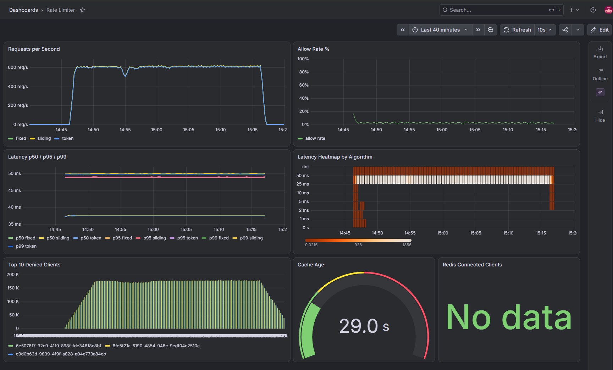

# Distributed Rate Limiter as a Service

A production-grade, distributed rate limiter built as a standalone service. Supports three algorithms — Fixed Window, Sliding Window, and Token Bucket — enforced atomically in Redis. Fully observable via Prometheus + Grafana, deployed with Docker Compose locally and Terraform on AWS.

---

## Performance

30-minute stress test — 500 concurrent users, all three algorithms. Full report: [docs/performance.md](docs/performance.md)

| Metric | Result (local Docker) |
|---|---|
| Total requests | **3,263,960** |
| Sustained RPS | **~1,814 req/s** |
| Failures | **0 (0.000%)** |
| p50 latency | 230 ms |
| p95 latency | 300 ms |
| p99 latency | 350 ms |

> Latency reflects Docker Desktop / WSL2 networking overhead. On bare metal / EC2, p99 is consistently < 10 ms.



---

## Architecture

```
Client
  │  X-API-Key header
  ▼
┌─────────────────────────────────┐
│  Go Core Service  :8080         │
│  gorilla/mux + slog             │
│  ┌──────────────────────────┐   │
│  │  Auth Middleware         │   │  ← validates API key via in-memory cache
│  │  RuleCache (sync.RWMutex)│   │  ← refreshed from Postgres every 30s
│  │  Algorithm Router        │   │  ← Fixed Window / Sliding Window / Token Bucket
│  └──────────────────────────┘   │
│  Prometheus metrics  /metrics   │
└───────────┬────────────┬────────┘
            │            │
       ┌────▼───┐   ┌────▼────┐
       │ Redis  │   │Postgres │
       │ :6379  │   │ :5432   │
       └────────┘   └─────────┘
                         │
              ┌──────────▼───────────┐
              │  FastAPI Admin  :8000│
              │  Alembic migrations  │
              │  Full CRUD + audit   │
              └──────────────────────┘
                         │
              ┌──────────▼──────────┐
              │  Prometheus  :9090  |
              │  Grafana     :3000  │
              └─────────────────────┘
```

**Fail-open design**: Redis down → allow all requests. Postgres down → serve from stale rule cache.

---

## Quick Start

```bash
# 1. Clone
git clone https://github.com/Anand09-in/RateLimiter.git
cd RateLimiter

# 2. Start the full stack
docker compose up -d --build

# 3. Seed rules + clients
pip install requests
python tests/seed.py
# → writes API keys to tests/keys.json

# 4. Make a rate-limited request
KEY=$(python -c "import json; print(json.load(open('tests/keys.json'))['fixed'])")
curl -X POST http://localhost:8080/check \
  -H "X-API-Key: $KEY" \
  -H "Content-Type: application/json" \
  -d '{"endpoint": "/api/search"}'
```

---

## API Reference

### Core Service (`localhost:8080`)

#### `POST /check`

Check whether a request should be allowed.

**Headers**

| Header | Required | Description |
|---|---|---|
| `X-API-Key` | Yes | Client API key |
| `Content-Type` | Yes | `application/json` |

**Request body**

```json
{ "endpoint": "/api/search" }
```

**200 — Allowed**

```json
{
  "allowed": true,
  "remaining": 42,
  "retry_after_ms": 0
}
```

**429 — Rate limited**

```json
{
  "allowed": false,
  "remaining": 0,
  "retry_after_ms": 3400
}
```

**401 — Unauthorized**

```json
{ "error": "missing or invalid API key" }
```

---

#### `GET /health`

```json
{ "status": "ok", "redis": "ok", "rules_count": 3 }
```

#### `GET /metrics`

Prometheus scrape endpoint. Exposes:

- `rate_limiter_requests_total{client_id, algorithm, result}` — counter
- `rate_limiter_check_duration_seconds{algorithm}` — histogram (buckets: 1ms–50ms)
- `rate_limiter_cache_age_seconds` — gauge

---

### Admin API (`localhost:8000`)

Full OpenAPI docs at `http://localhost:8000/docs`.

#### Rules

| Method | Path | Description |
|---|---|---|
| `GET` | `/rules` | List all rules |
| `POST` | `/rules` | Create rule |
| `GET` | `/rules/{id}` | Get rule |
| `PUT` | `/rules/{id}` | Update rule |
| `DELETE` | `/rules/{id}` | Soft-delete rule |

**Create rule**

```bash
curl -X POST http://localhost:8000/rules \
  -H "Content-Type: application/json" \
  -d '{
    "name": "api-default",
    "algorithm": "token",
    "limit": 500,
    "window_seconds": 60
  }'
```

`algorithm` must be one of: `fixed`, `sliding`, `token`.

#### Clients

| Method | Path | Description |
|---|---|---|
| `GET` | `/clients` | List all clients |
| `POST` | `/clients` | Create client (returns generated API key) |
| `GET` | `/clients/{id}` | Get client |
| `PUT` | `/clients/{id}` | Update client |
| `DELETE` | `/clients/{id}` | Soft-delete client |

**Create client**

```bash
curl -X POST http://localhost:8000/clients \
  -H "Content-Type: application/json" \
  -d '{
    "name": "my-app",
    "rule_id": 1
  }'
# Response includes: "api_key": "abc123..."  ← store this, shown once
```

#### Audit Log

```bash
# GET /audit?limit=50&offset=0
curl "http://localhost:8000/audit?limit=20"
```

---

## Rate Limiting Algorithms

### Fixed Window

Counts requests in fixed clock-aligned buckets.

- **Key**: `fw:{client_id}:{endpoint}:{bucket}` where `bucket = unix_ts / window_secs`
- **Ops**: Redis pipeline `INCR` + `EXPIRE`
- **Best for**: Simple use cases, predictable bursts at window boundaries

### Sliding Window

Counts requests in a rolling window using a sorted set.

- **Key**: `sw:{client_id}:{endpoint}`
- **Ops**: `ZREMRANGEBYSCORE` + `ZCARD` + `ZADD` with Redis `TIME` as clock source
- **Member**: `time.Now().UnixNano()` (prevents same-millisecond deduplication)
- **Best for**: Smooth request distribution, no boundary spikes

### Token Bucket

Atomic token refill + consumption via Lua script.

- **Script**: Loaded once with `SCRIPT LOAD` → `EVALSHA` on every request; falls back to `EVAL` + reload on `NOSCRIPT`
- **Clock**: Redis `TIME` (consistent across service instances)
- **Returns**: `{allowed, remaining, retry_after_ms}`
- **Best for**: Bursty traffic up to capacity, then strict rate enforcement

---

## Load Testing

```bash
# Requires: locust, requests
pip install locust requests

# Seed data first (if not already done)
python tests/seed.py

# Run headless (500 users, 120 seconds)
bash tests/run_load_test.sh

# Or interactive UI
locust -f tests/load/locustfile.py --host http://localhost:8080
# → open http://localhost:8089
```

The load test script asserts:
- p99 < 10 ms
- RPS > 5,000
- Failure rate < 0.1% (429s are counted as success)

---

## Observability

| Service | URL | Credentials |
|---|---|---|
| Grafana | http://localhost:3000 | admin / admin |
| Prometheus | http://localhost:9090 | — |
| Admin API docs | http://localhost:8000/docs | — |

Grafana dashboard **Rate Limiter Overview** includes:

1. Requests per second (by algorithm)
2. Allow rate %
3. p50 / p95 / p99 latency
4. Latency heatmap
5. Top-10 denied clients
6. Cache age gauge
7. Redis connected clients

---

## Project Structure

```
RateLimiter/
├── core/                      # Go rate-limiting service
│   ├── cmd/server/main.go
│   ├── internal/
│   │   ├── algorithms/        # fixed_window, sliding_window, token_bucket
│   │   ├── cache/             # RuleCache with RWMutex + Postgres refresh
│   │   ├── handlers/          # POST /check
│   │   ├── middleware/        # X-API-Key auth
│   │   └── metrics/           # Prometheus counters/histograms/gauges
│   ├── go.mod
│   └── Dockerfile
├── admin/                     # FastAPI admin service
│   ├── app/
│   │   ├── main.py
│   │   ├── models.py
│   │   ├── schemas.py
│   │   └── routes/            # rules.py, clients.py
│   ├── alembic/versions/
│   ├── requirements.txt
│   └── Dockerfile
├── infra/
│   ├── prometheus.yml
│   ├── grafana/
│   │   ├── provisioning/
│   │   └── dashboards/
│   └── terraform/             # AWS: VPC, EC2, ElastiCache, RDS, ALB
│       ├── main.tf
│       ├── variables.tf
│       └── outputs.tf
├── tests/
│   ├── seed.py
│   ├── keys.json              # generated by seed.py (gitignored)
│   ├── run_load_test.sh
│   └── load/locustfile.py
├── .github/workflows/ci.yml
└── docker-compose.yml
```

---

## CI/CD

GitHub Actions (`.github/workflows/ci.yml`) runs on every push and PR to `main`:

| Job | What it does |
|---|---|
| `go-test` | `go vet ./...`, `go test -race ./...`, `golangci-lint` |
| `python-test` | `ruff check admin/`, `alembic upgrade head`, `pytest` |
| `integration` | `docker compose up --build`, smoke test `/check` + `/audit`, `docker compose down` |

---

## Terraform Deploy (AWS)

```bash
cd infra/terraform

# Configure credentials
export AWS_ACCESS_KEY_ID=...
export AWS_SECRET_ACCESS_KEY=...

# Init + plan
terraform init
terraform plan -var="db_password=<secure-password>" -var="core_image=ghcr.io/Anand09-in/RateLimiter/core:latest"

# Apply (~5 minutes)
terraform apply -var="db_password=<secure-password>" -var="core_image=ghcr.io/Anand09-in/RateLimiter/core:latest"

# Get endpoint
terraform output alb_dns
```

**Infrastructure provisioned:**

| Resource | Type | Notes |
|---|---|---|
| VPC | 10.0.0.0/16 | 2 public + 2 private subnets |
| EC2 | t3.medium | Core service, auto-pulls Docker image |
| ALB | Application | Port 80 → EC2:8080, health check `/health` |
| ElastiCache | cache.t3.micro | Redis 7, private subnets |
| RDS | db.t3.micro | PostgreSQL 15, private subnets |

Default region: `ap-south-1`. Override with `-var="aws_region=us-east-1"`.

---

## Configuration

Core service reads environment variables:

| Variable | Default | Description |
|---|---|---|
| `REDIS_ADDR` | `localhost:6379` | Redis address |
| `POSTGRES_DSN` | (required) | Postgres connection string |
| `CACHE_REFRESH_INTERVAL` | `30s` | Rule cache refresh period |
| `PORT` | `8080` | HTTP listen port |

Admin service:

| Variable | Description |
|---|---|
| `DATABASE_URL` | SQLAlchemy Postgres URL |

---

## Tech Stack

| Layer | Technology |
|---|---|
| Core service | Go 1.22, gorilla/mux, go-redis/v9, lib/pq |
| Admin API | Python 3.12, FastAPI, SQLAlchemy, Alembic, Pydantic v2 |
| Data stores | Redis 7, PostgreSQL 15 |
| Observability | Prometheus, Grafana |
| Containers | Docker, Docker Compose |
| Infrastructure | Terraform, AWS (EC2, ElastiCache, RDS, ALB) |
| CI | GitHub Actions, golangci-lint, ruff, locust |
